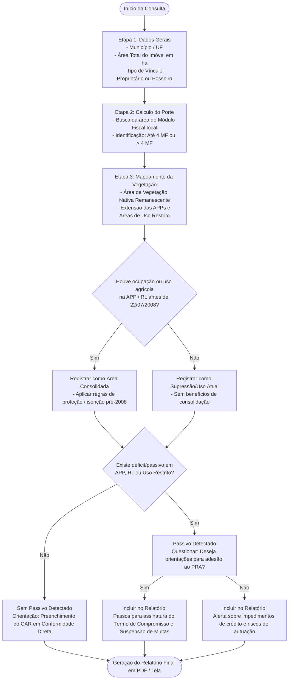

# Módulo de Consulta e Diagnóstico para Preenchimento do CAR

Módulo interativo no formato passo a passo (Wizard) desenvolvido para guiar o proprietário ou técnico em uma consulta diagnóstica. O objetivo final do fluxo é gerar um Relatório Orientativo de Preenchimento, indicando exatamente como o Cadastro Ambiental Rural (CAR) deve ser declarado no sistema oficial (SICAR), quais regras se aplicam ao imóvel e quais providências tomar em relação ao Programa de Regularização Ambiental (PRA).

---

## Visão Geral do Sistema

Em vez de realizar a submissão direta, o sistema atua como uma ferramenta de consultoria e pré-diagnóstico. Através de perguntas encadeadas e dados informados pelo usuário, o motor de regras analisa o enquadramento do imóvel na Lei nº 12.651/2012 e emite um documento final com instruções detalhadas.

### Principais Entregáveis do Relatório
* **Resumo do Enquadramento:** Classificação do imóvel por Módulos Fiscais (até 4 MF vs. superior a 4 MF).
* **Instruções para Marcação de Áreas:** Orientações sobre o que declarar como Área Consolidada, APP ou Uso Restrito.
* **Cálculo da Reserva Legal Exigida:** Indicação da porcentagem e metragem exatas de RL necessárias (considerando isenções do marco de 2008).
* **Plano de Ação para Passivos:** Recomendações sobre a adesão ao PRA e modalidades de recomposição/compensação.

---

## Fluxo da Consulta (Passo a Passo do Usuário)



---

## Passo a Passo Detalhado do Questionário

### Etapa 1: Caracterização e Perfil do Imóvel
1. **Qual o município e UF do imóvel?** *(O sistema resgata automaticamente o valor em hectares do Módulo Fiscal local).*
2. **Qual a área total do imóvel rural (em hectares)?**
3. **Qual a condição do declarante?** *(Proprietário ou Posseiro).*

### Etapa 2: Mapeamento do Uso do Solo e Vegetação
1. **Qual a área ocupada por remanescentes de vegetação nativa (ha)?**
2. **Existem cursos d'água, nascentes, lagos, topos de morro ou encostas declivosas na propriedade?**
3. **Qual a área total aproximada dessas APPs (ha)?**

### Etapa 3: Histórico e Marco Temporal (22/07/2008)
1. **As áreas de cultivo, pastagem ou benfeitorias em APP/RL foram estabelecidas até 22 de julho de 2008?**
   * *Se SIM:* O sistema classifica como **Área Consolidada** (libera isenção de recomposição integral para imóveis de até 4 Módulos Fiscais).
   * *Se NÃO:* O sistema classifica como **Supressão Recente** (exige recomposição de 100%).

### Etapa 4: Apuração do Passivo e Decisão pelo PRA
1. **O imóvel possui área de vegetação inferior à exigida por lei para a Reserva Legal da região?**
2. **Em caso de passivo, o declarante deseja receber orientações para aderir ao Programa de Regularização Ambiental (PRA)?**

---

## Estrutura do Relatório Gerado para o Usuário

Ao finalizar as etapas, o sistema gera uma minuta/relatório com a seguinte estrutura de dados:

```json
{
  "protocoloConsulta": "DIAG-CAR-2026-9876",
  "dataEmissao": "2026-10-13",
  "resumoImovel": {
    "municipioUF": "São Bento do Sul / SC",
    "areaTotalHa": 35.0,
    "moduloFiscalHa": 14.0,
    "quantidadeMF": 2.5,
    "enquadramento": "Pequena Propriedade / Agricultura Familiar (<= 4 MF)"
  },
  "diagnosticoEInstrucoes": {
    "reservaLegal": {
      "percentualExigido": "20%",
      "regraAplicada": "Isenção de recomposição além do remanescente existente em 22/07/2008 (Art. 67 do Código Florestal).",
      "comoPreencherNoCAR": "Declarar a RL na aba 'Reserva Legal' selecionando a opção 'Pequena Propriedade - Área Consolidada'."
    },
    "appEAreasConsolidadas": {
      "possuiAreaConsolidada": true,
      "comoPreencherNoCAR": "Marcar na aba 'Uso Consolidado' a faixa antropizada pré-2008 ao longo dos cursos d'água."
    },
    "regularizacaoPRA": {
      "status": "Adesão Recomendada",
      "beneficios": "Suspensão de sanções e multas por infrações anteriores a 22/07/2008.",
      "proximosPassos": [
        "1. Realizar a inscrição no SICAR com os dados acima.",
        "2. Selecionar a opção 'Desejo aderir ao PRA' no momento da transmissão.",
        "3. Aguardar a notificação do órgão ambiental estadual para assinatura do Termo de Compromisso (TC)."
      ]
    }
  }
}
```

---

## Dicas para Implementação da Interface (Front-end)

* **Progresso Visual:** Exiba uma barra de progresso (ex: Etapa 3 de 5) para aumentar o engajamento do usuário.
* **Ajuda Contextual (Tooltips):** Insira explicações simples ao lado de termos técnicos (ex: explicar o que é Módulo Fiscal ou Área Consolidada sem jargões jurídicos).
* **Exportação:** Permita que o usuário faça o download do relatório resultante em PDF para servir de guia no momento do preenchimento oficial do CAR.